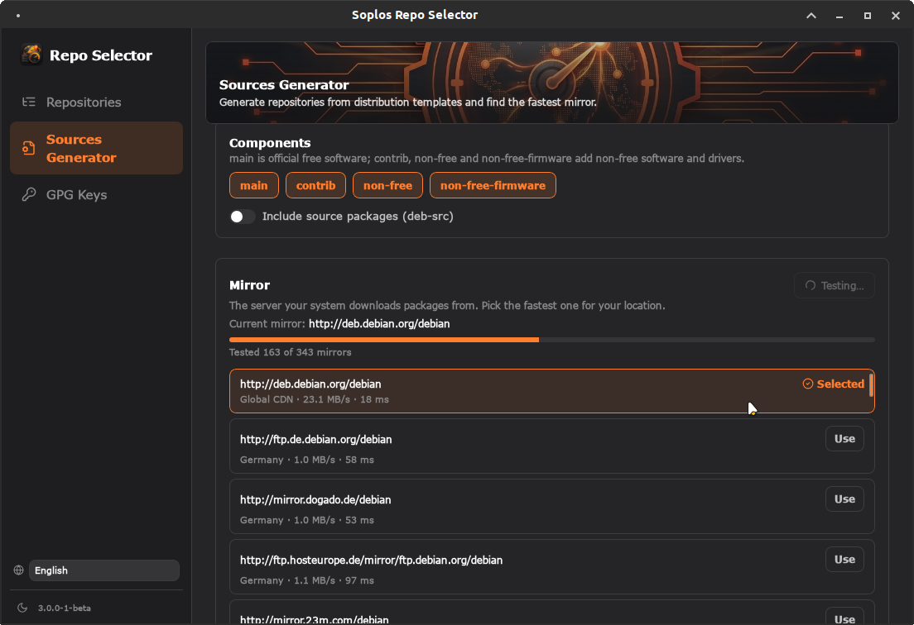

# Soplos Repo Selector 3.0

Advanced APT repository manager for Soplos Linux.

Enable or disable repositories, modernize legacy `.list` files to DEB822 `.sources`, find the fastest mirror with a real speed test, and manage GPG signing keys — including flagging keys no repository uses anymore.

## Screenshots

| | |
|---|---|
|  Repositories list, with repos enabled or disabled per source |  Sources Generator: choosing distribution, components and mirror |
|  Sources Generator: live mirror speed test |  GPG Keys: imported Debian and third-party signing keys |

## Architecture

Version 3.0 is a ground-up rewrite of Soplos Repo Selector. The original app was written in Python 3 with GTK3 (PyGObject), the same skeleton every other Soplos GTK tool follows. This rewrite replaces that entire stack with Tauri 2: a Rust backend and a Svelte 4 + Tailwind CSS frontend, rendered through the system's WebKitGTK — the same architecture introduced by Soplos Welcome 3.0.

- **Backend** (`src-tauri/`): every privileged operation (saving repo files, modernizing `.list` to `.sources`, GPG key import/delete, creating `/etc/apt/keyrings`) goes through a single polkit-gated `run_elevated()` helper (`src-tauri/src/privilege/`), authorized by `resources/polkit/org.soplos.reposelector.policy` — the same pattern used by Soplos Welcome 3.0. The mirror speed test streams real downloads to measure throughput rather than relying on ping latency.
- **Frontend** (`src/`): three sections — Repositories, Sources Generator and GPG Keys — a shared popup component, and the 8-language dictionaries under `src/i18n/`.

This is the third Soplos application ported to this architecture, after Soplos Welcome 3.0 and Soplos AppImage Manager 3.0. The plan is to move the rest of the Python/GTK3 Soplos tools to the same pattern over time.

## Installation

```bash
sudo apt install soplos-repo-selector
```

Open it from the applications menu. Press F1 for the About dialog.

## Features

- Enable, disable and inspect every configured APT repository.
- Modernize legacy `/etc/apt/sources.list` and `.list` files to the DEB822 `.sources` format.
- Real mirror speed test across Debian's mirror network, grouped by country, to pick the fastest one.
- Import, export and delete GPG signing keys, with details (fingerprint, expiry, UID) on demand.
- Unused-key detection: flags a key when no configured repository references it anymore and it doesn't belong to any installed package, so it's safe to tell apart from a system keyring like debian-archive-keyring.
- Keyboard shortcuts: F1 (About), Ctrl+Q (quit), Ctrl+Tab / Ctrl+Shift+Tab (cycle sections).

## Languages

The interface is available in English, Spanish, German, French, Italian, Portuguese, Romanian and Russian. It starts in the system language and falls back to English.

## License

GPL-3.0-or-later. See `LICENSE`.
