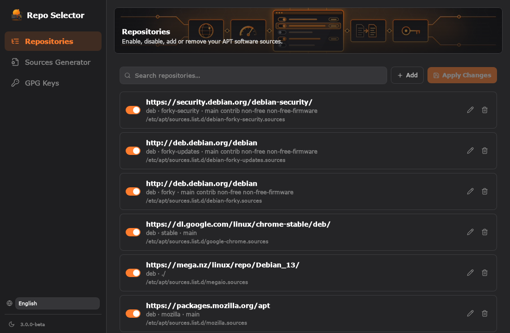

# Soplos Repo Selector 3.0

[](https://www.gnu.org/licenses/gpl-3.0)
[]()

Advanced APT repository manager for Soplos Linux.

Enable or disable repositories, modernize legacy `.list` files to DEB822 `.sources`, find the fastest mirror with a real speed test, and manage GPG signing keys — including flagging keys no repository uses anymore.

## Screenshots

| | |
|---|---|
|  **Repositories**: manage and toggle software archives per source |  **Sources Generator**: distribution, components and mirror selector |
|  **Speed test**: live throughput benchmark across worldwide Debian mirrors |  **GPG Keys**: trusted keyrings, fingerprint details and unused key detection |

## Architecture

Version 3.0 is a ground-up rewrite of Soplos Repo Selector. The original app was written in Python 3 with GTK3 (PyGObject). This rewrite replaces that entire stack with Tauri 2: a Rust backend and a Svelte 4 + Tailwind CSS frontend, rendered through the system's WebKitGTK.

- **Backend** (`src-tauri/`): privileged operations (writing repo files, modernizing `.list` to `.sources`, importing or deleting GPG keys, creating `/etc/apt/keyrings`) run through a single polkit-gated helper (`src-tauri/src/privilege/`), authorized by `resources/polkit/org.soplos.reposelector.policy`. The mirror speed test streams actual package index downloads to measure real network throughput rather than raw ping latency.
- **Frontend** (`src/`): three core views — Repositories, Sources Generator and GPG Keys — shared dialogs, and the 8-language dictionaries under `src/i18n/`.
- **Privileges**: root actions require authentication through Polkit; the GUI itself never runs as the superuser.

## Installation

```bash
sudo apt install soplos-repo-selector
```

## Features

- **Repository management**: inspect, enable, and disable every configured APT repository.
- **DEB822 modernization**: convert legacy `/etc/apt/sources.list` and `.list` entries to Debian's modern DEB822 `.sources` format.
- **Live mirror benchmark**: real-time streaming download tests to detect the fastest official Debian mirrors.
- **Keyring management**: import, export, inspect, and remove GPG signing keys with full fingerprint and expiry details.
- **Unused key detection**: automatically flags imported keys that are no longer referenced by any active repository and do not belong to an installed system package.

## Keyboard shortcuts

| Shortcut | Action |
|---|---|
| F1 | Open About dialog |
| Ctrl+Q | Quit application |
| Ctrl+Tab | Next section |
| Ctrl+Shift+Tab | Previous section |

## Documentation

A Unix manual page is included and installed with the package:

```bash
man soplos-repo-selector
```

## Languages

The interface is available in 8 languages: English, Español, Deutsch, Français, Italiano, Português, Română and Русский. It starts in the system language and falls back to English.

## Building

```bash
npm install
npm run tauri dev      # development
./package.sh           # builds the .deb and moves it to ~/Descargas/SoplosApps
```

## License

Copyright © 2026 Sergi Perich <info@soploslinux.com>. Published under the GPL-3.0-or-later license. See `LICENSE`.

